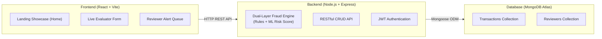

# SentinelPay 🛡️

### Real-Time Financial Fraud Detection & Human-in-the-Loop Review Platform

> **Course:** CS3301 Full Stack Development (Semester 5)  
> **Author:** Niteesh Balajee (`1RUA24SCS0066`)  
> **Tech Stack:** React (Vite), Node.js, Express.js, MongoDB (Mongoose), Git/GitHub  

---

## 📌 Architecture Overview



SentinelPay uses a **two-layer detection engine**:
1. **Layer 1: Rule-Based Policy Engine:** Catches foreign cards, velocity bursts, unusual transaction hours, and location mismatches with 100% explainable reasons.
2. **Layer 2: Statistical Anomaly Scoring:** Evaluates pattern deviations against historical transaction baselines.
3. **Reviewer Triage Queue:** Flagged transactions are placed in an analyst dashboard with exact reasons attached, avoiding auto-declines of honest users.
4. **Audit Trail:** Every approval or fraud block is permanently stamped with analyst identity and timestamp.

---

## 📋 Course Curriculum Alignment (All 5 Modules)

| Module | Curriculum Topics | Status | Implementation in SentinelPay |
| :--- | :--- | :---: | :--- |
| **Module 1** | HTML5, CSS3, ES6+ JS, DOM manipulation, Git & GitHub | ✅ 100% | Semantic landing page (`index.html`, `style.css`, `script.js`), 4 merged GitHub PRs. |
| **Module 2** | React, JSX, Components, Props, State, Forms, React Router | ✅ 100% | Modular React architecture in `client/`, controlled Evaluator form, `TransactionContext`, `react-router-dom`. |
| **Module 3** | Node.js runtime, Express.js, RESTful CRUD, Middleware, Auth concepts | ✅ 100% | Express server in `server/`, full CRUD endpoints, 404/500 middleware, bcrypt + JWT authentication. |
| **Module 4** | SQL vs NoSQL, MongoDB, Mongoose schemas & CRUD, validations | ✅ 100% | Mongoose `Transaction` & `User` models, field validations, Atlas connection + graceful in-memory fallback. |
| **Module 5** | React-Express integration, `.env` security, Postman testing, Deployment, CI/CD | ✅ 100% | Client API service (`api.js`), `.env` configurations, Postman JSON collection, Render/Vercel configs, GitHub Actions CI. |

---

## 🚀 Quick Start Guide

### Prerequisites
* [Node.js](https://nodejs.org/) (v18 or higher)
* [Git](https://git-scm.com/)

### 1. Install All Dependencies
```powershell
npm run install:all
```

### 2. Start the Backend API (Port 5000)
```powershell
npm run dev:server
# or: cd server && npm run dev
```
* API Base: `http://localhost:5000`
* Health check: `http://localhost:5000/api/health`

### 3. Start the React Frontend (Port 5173)
In a separate terminal:
```powershell
npm run dev:client
# or: cd client && npm run dev
```

Open **`http://localhost:5173`** in your browser.

---

## 📡 RESTful API Reference

| Method | Endpoint | Description |
| :--- | :--- | :--- |
| `GET` | `/api/health` | System health check and MongoDB connection status |
| `POST` | `/api/transactions` | Evaluate & ingest transaction through the dual-layer fraud engine |
| `GET` | `/api/transactions` | List all transactions (supports `?status=FLAGGED` and `?search=term`) |
| `GET` | `/api/transactions/:id` | Retrieve single transaction details |
| `PATCH` | `/api/transactions/:id/review` | Analyst triage: update status (`SAFE` or `BLOCKED`) with reviewer notes |
| `DELETE` | `/api/transactions/:id` | Remove a transaction record |
| `GET` | `/api/transactions/stats/summary` | Aggregated analytics (total, flagged, blocked, cleared, accuracy) |
| `POST` | `/api/auth/register` | Register a new analyst account |
| `POST` | `/api/auth/login` | Authenticate reviewer and receive JWT bearer token |
| `GET` | `/api/auth/profile` | Protected reviewer profile (requires `Bearer <token>`) |

---

## 🧪 Postman API Testing

A complete Postman collection is included in the project:  
📁 **[`postman/SentinelPay_API_Collection.json`](./postman/SentinelPay_API_Collection.json)**

**How to use:**
1. Open Postman.
2. Click **Import** -> Select `postman/SentinelPay_API_Collection.json`.
3. Set collection variable `baseUrl` to `http://localhost:5000`.
4. Run requests to test transactions, triage workflows, and authentication.

---

## 🌐 Deployment Configuration
* **Backend (Render):** Defined in [`render.yaml`](./render.yaml). Point your Render web service to the `server/` root directory with build command `npm install` and start command `npm start`.
* **Frontend (Vercel / Netlify):**  
  * Vercel SPA routing configured in [`client/vercel.json`](./client/vercel.json).  
  * Netlify deployment configured in [`client/netlify.toml`](./client/netlify.toml).

---

## 🔄 CI/CD Pipeline (Module 5 Concept)

An automated continuous integration workflow is set up at [`.github/workflows/ci.yml`](./.github/workflows/ci.yml):
* **Trigger:** Automatically runs on every `push` and `pull_request` to the `main` branch.
* **Pipeline Steps:**  
  1. Checks out repository code.  
  2. Sets up Node.js environment.  
  3. Installs and tests backend server integrity.  
  4. Installs dependencies and builds the React client with Vite.

